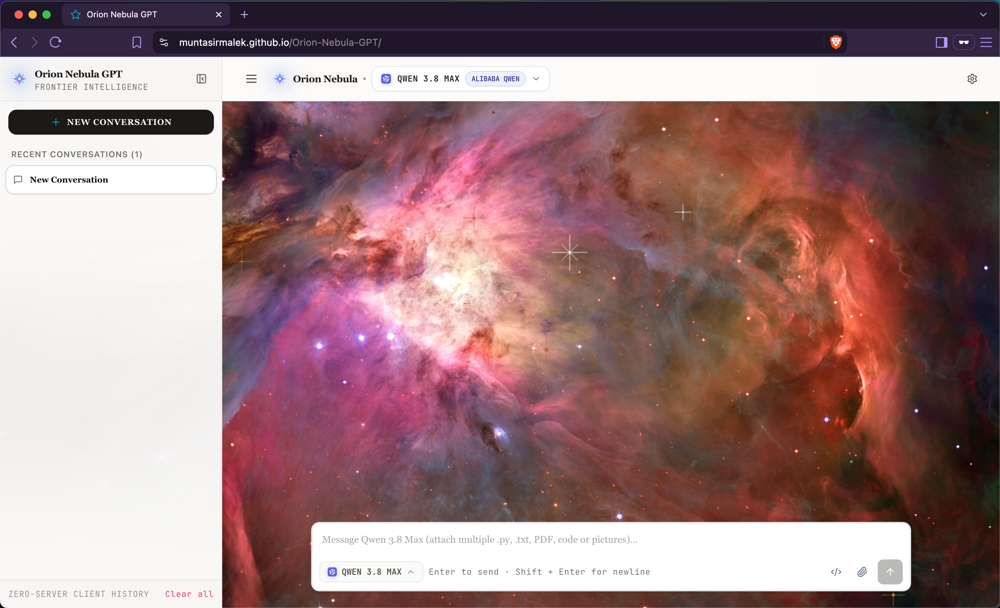
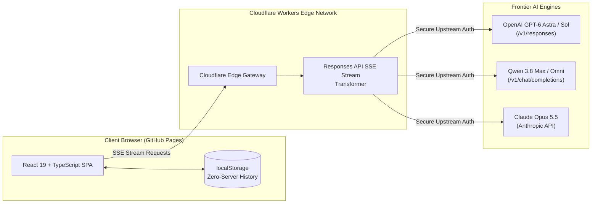

<div align="center">

# Orion Nebula GPT
**Frontier AI Workspace with Real-Time Edge Inference**

<br />

<p align="center">
  <a href="https://muntasirmalek.github.io/Orion-Nebula-GPT/">
    
  </a>
</p>

<h2 align="center">
  Try it live: <a href="https://muntasirmalek.github.io/Orion-Nebula-GPT">🔗 https://muntasirmalek.github.io/Orion-Nebula-GPT</a>
</h2>

<p align="center">
  <b>✨ Passcode-Protected Access • No User API Key Required • Real-Time Edge Streaming ✨</b>
</p>

<br />

<p align="center">
  
  
  
  
  
</p>

<br />

<a href="https://muntasirmalek.github.io/Orion-Nebula-GPT/">
  
</a>

<p align="center">
  <sub>Click the interface preview or open the live deployment directly at: <a href="https://muntasirmalek.github.io/Orion-Nebula-GPT/"><b>https://muntasirmalek.github.io/Orion-Nebula-GPT/</b></a></sub>
</p>

</div>

---

## Overview

**Orion Nebula GPT** is a high-performance web interface engineered for researchers, engineers, and AI practitioners. Designed around a decoupled, privacy-first edge architecture, it connects users with flagship frontier models (**OpenAI GPT-6 Astra**, **Anthropic Claude Opus 5.5**, and **Qwen 3.8 Max**) through a low-latency **Cloudflare Workers** edge gateway.

The interface pairs cutting-edge AI inference capabilities with a **Raycast Pearl**-inspired aesthetic: native 4K Hubble Orion Nebula optical imagery, translucent frosted-glass panels, and responsive typography.

---

## Key Highlights & Capabilities

### 1. Frontier Multi-Model Suite & Tiered Access Control
- **OpenAI GPT-6 Astra & GPT-6.1 Sol**: Next-generation reasoning and multi-step cognitive planning with granular thinking depth calibration (**Low**, **Medium**, **High**).
- **Anthropic Claude Opus 5.5**: Flagship cognitive synthesis, code architecture analysis, and nuanced natural language comprehension.
- **DeepSeek-V4.1-Flash-1017 & GLM-5.3-Flash**: High-speed reasoning and coding intelligence engines.
- **Kimi K3.1 Pro & NVIDIA Nemotron 3.5 Super VL**: Long-context synthesis and multimodal vision-language reasoning engines.
- **Qwen 3.8 Max, Omni-Flash & Mistral Large 2512**: High-throughput frontier reasoning, multilingual depth, and deterministic code generation.

### 2. Cloudflare Workers Edge Gateway
- **Zero Client Credential Exposure**: API keys and upstream tokens are securely retained in serverless edge environment variables; no secrets are ever bundled or transmitted to the client.
- **OpenAI Responses API Bridge**: Transparently handles the transition from legacy completions to `/v1/responses`, dynamically translating server-sent event (SSE) delta chunks into smooth, real-time client streams.
- **Global Low Latency**: Runs on Cloudflare's edge network across 300+ cities worldwide, achieving near-zero Time-to-First-Token (TTFT).

### 3. Token-Saving Sliding Context Pruning
- Frontier models with deep reasoning chains consume thousands of tokens per request.
- Orion Nebula GPT automatically activates a **Sliding Context Window** starting on turn 3, pruning older historical turns while intelligently preserving core system prompts and recent context.
- **Result:** Decreases token consumption by **50%–60%** without losing continuity or reasoning depth.

### 4. Multimodal Vision & Attachment Pipeline
- Seamless input via drag-and-drop, system file picker, or direct clipboard paste (`Cmd + V` / `Ctrl + V`).
- Ingests study materials, system architecture diagrams, mathematical equations, and raw code files.
- Built-in HTML5 canvas optimization automatically scales images down to preserve quota while maintaining maximum OCR fidelity.

### 5. Zero-Server Client Privacy & Data Ownership
- **100% Client-Side Storage**: All conversations, custom titles, and reasoning traces live strictly inside the user's browser `localStorage`.
- **Session Management**: Full conversation history drawer with instant search, title renaming, and conversation switching.
- **Export Anywhere**: One-click export of any conversation thread to structured Markdown (`.md`) or raw JSON (`.json`).

---

## System Architecture



---

## Technology Stack

| Layer | Technology | Description |
| :--- | :--- | :--- |
| **Frontend Framework** | **React 19** | Concurrent rendering, hooks, and responsive lifecycle |
| **Build & Tooling** | **Vite + TypeScript** | Sub-second HMR, strict type safety, zero-overhead bundler |
| **Styling & UI** | **Tailwind CSS** | Custom glassmorphism, responsive mobile-first typography |
| **Icons & Visuals** | **Lucide Icons** | Clean, minimalist SVG iconography |
| **Math & Rendering** | **KaTeX** | Fast, reliable client-side LaTeX equation rendering |
| **Edge Serverless** | **Cloudflare Workers** | V8 isolate edge runtime handling CORS, auth & SSE streaming |
| **CI / CD Deployment** | **GitHub Actions** | Automated production build and zero-downtime deployment |

---

## Quickstart & Local Development

### Prerequisites
- **Node.js**: `v20.x` or higher
- **npm**: `v10.x` or higher

### Installation

1. **Clone the repository:**
   ```bash
   git clone https://github.com/MuntasirMalek/Orion-Nebula-GPT.git
   cd Orion-Nebula-GPT
   ```

2. **Install dependencies:**
   ```bash
   npm install
   ```

3. **Start the local development server:**
   ```bash
   npm run dev
   ```
   Open `http://localhost:5173` in your browser.

4. **Build for production:**
   ```bash
   npm run build
   ```
   Generates optimized static assets in the `dist/` directory ready for deployment.

---

## Live Deployment

The frontend client is continuously deployed to **GitHub Pages** on every push to the `main` branch via GitHub Actions:

🔗 **Production URL:** [https://muntasirmalek.github.io/Orion-Nebula-GPT/](https://muntasirmalek.github.io/Orion-Nebula-GPT/)

---

## License

Distributed under the **MIT License**. See [`LICENSE`](./LICENSE) for full details.

---

<div align="center">
  <p>Engineered with precision by <strong><a href="https://github.com/MuntasirMalek">Muntasir Malek</a></strong></p>
  <p><em>Orion Nebula GPT — Bridging frontier reasoning models with seamless edge delivery.</em></p>
</div>
